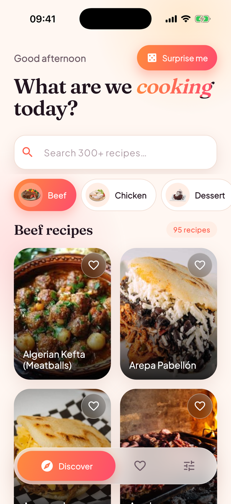
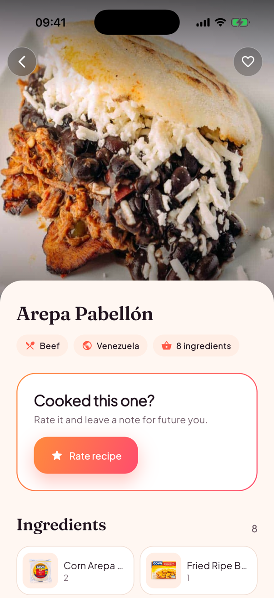
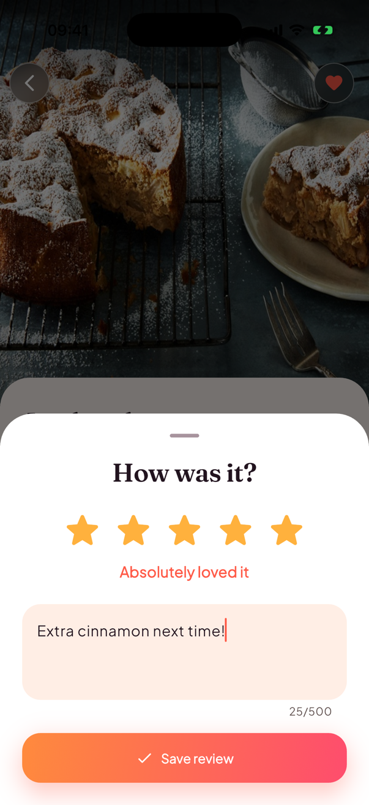

# Savora

A recipe explorer built with Flutter as an architecture showcase. It browses
[TheMealDB](https://www.themealdb.com/api.php) (public, no API key), lets you
save recipes and rate/review them, works offline from cache, and ships in
English and Serbian with light and dark themes.

## Demo

<p align="center">
  
</p>

A 23-second walkthrough recorded on the iPhone 17 Pro simulator, with the pauses between taps cut out. It shows the sliding category picker, the hero transition into a recipe, a 5-star review, saving recipes, the Saved tab, and a live switch to dark mode and Serbian. A sharper version is in [`docs/showcase.mp4`](docs/showcase.mp4).

| Discover | Recipe | Review | Settings (dark, Serbian) |
| :---: | :---: | :---: | :---: |
|  |  |  |  |

## Features

- **Discover**: category chips, a debounced search, a 2-column grid with staggered entrance animations, a collapsing header and a "Surprise me" random pick.
- **Recipe detail**: a hero image that flies in from the grid, a stretchy app bar, ingredient tiles with images, a step-by-step timeline, and YouTube/source links.
- **Rate & review**: 1–5 stars plus a note. Stored on the device, with edit and delete.
- **Saved**: favourites persisted with their full summary, so the tab renders offline. Swipe to remove, with undo.
- **Settings**: theme (system/light/dark) and language (system/English/Srpski), both persisted. The first launch is in English.
- **Offline-first caching**: see [Caching](#caching).

## Running

```bash
flutter pub get
flutter run
```

Generated code is committed, so the app builds right away. To regenerate it:

```bash
flutter gen-l10n                       # lang/*.arb  → lib/i18n
dart run build_runner build -d         # json_serializable → *.g.dart
```

Quality gates (also run in CI, see `.github/workflows/ci.yml`):

```bash
dart format --set-exit-if-changed lib test
flutter analyze
flutter test
```

## Architecture

Code is organised by feature. Each feature uses the same `models / repository / bloc / ui` layout:

```
lib/
├── core/                 # cross-cutting, feature-agnostic
│   ├── di/               # composition root (get_it)
│   ├── network/          # ApiClient, Result<T>, AppFailure
│   ├── storage/          # KeyValueStorage abstraction
│   ├── router/           # go_router + StatefulShellRoute
│   ├── theme/            # AppColors ThemeExtension, AppTheme, tokens
│   └── widgets/          # design-system atoms (glass, shimmer, buttons…)
├── meals/                # browse + detail + random
├── reviews/              # local rate & review
├── favorites/            # saved recipes
├── settings/             # theme + locale
└── shell/                # floating glass bottom navigation
lang/                     # app_en.arb, app_sr.arb  (source of truth for copy)
```

Data flows one way:

```
UI ──events──▶ Bloc/Cubit ──▶ Repository (interface) ──▶ RemoteDataSource ──▶ ApiClient ──▶ http.Client
 ▲                 │                   └──────────────▶ LocalDataSource  ──▶ KeyValueStorage
 └───── state ─────┘
```

### Key decisions

| Decision | Why |
| --- | --- |
| **Constructor injection everywhere. `GetIt` is only used in `core/di` and the router.** | No class reaches into a service locator, so every class can be built in a test with fakes, and its dependencies are visible in its constructor. |
| **Repositories are `interface`s with one implementation.** | Blocs depend on the contract. Tests mock the contract, and swapping a local store for a backend would not touch blocs or UI. |
| **Blocs/Cubits are not registered in the DI container.** | Their lifetime belongs to the widget tree (`BlocProvider` at the route), so they are closed when the screen goes away. |
| **`Result<T>` + sealed `AppFailure` instead of exceptions or nullable fields.** | The compiler forces both branches to be handled through exhaustive `switch`. The UI maps failures to localised copy (`AppFailureL10n`), never to raw HTTP messages. |
| **Immutable, `Equatable` state.** `MealsState` uses a status enum with `copyWith`. Detail and random use sealed state classes. | `buildWhen`/`select` work properly, `bloc_test` can compare states, and widgets render only from state, never from getters on the bloc. |
| **`Bloc` for Discover, `Cubit` elsewhere.** | Discover gets something real from events: search is debounced and loads are `restartable`, so a slow response can never overwrite a newer selection. Simpler screens don't need events. |
| **One-shot side effects through `BlocListener`.** | "Surprise me" emits `RandomMealReady`, and the listener navigates. Navigation never happens inside the cubit. |
| **Design tokens in a `ThemeExtension`.** | `context.colors.primary` works in both themes and animates between them (`lerp`). Widgets have no hard-coded colours. |
| **Strict analysis.** | `strict-casts`, `strict-inference`, `strict-raw-types`, plus the same strict lint set I use in production projects. |

### Caching

`MealsRepositoryImpl` uses a different strategy for each kind of data:

| Data | Strategy | TTL |
| --- | --- | --- |
| Categories | cache-first | 1 day |
| Meal detail | cache-first (also warmed by "Surprise me") | 7 days |
| Category listing | network-first, stale cache on `NetworkFailure` | — |
| Search | network only | — |

The cache stores the raw JSON with a timestamp (`MealsLocalDataSource`). If the cache is corrupt, the entry is dropped instead of crashing.

### Localisation

Copy lives in `lang/*.arb` and is generated with `flutter gen-l10n` into `lib/i18n`. ICU plurals cover Serbian's `one/few/other` forms ("1 recept", "3 recepta", "5 recepata"), and dates are formatted per locale. To add a language, add `lang/app_xx.arb`. It then appears in Settings automatically.

## Testing

The 24 tests run in about a second and need no device or network:

- `ApiClient`: URL building, and mapping 404/5xx/bad JSON/socket errors to typed failures (`MockClient`).
- `MealsRepositoryImpl`: cache TTL hits and expiry, offline fallback, non-network failures not being masked by cache, and cache warming.
- `MealsBloc`: initial load, category switching, **search debouncing** (only the last query reaches the repository), and the failure path.
- `MealReviewCubit`, `FavoritesCubit`: persistence round-trips and undo position.
- `MealDetail.fromJson`: flattened ingredient parsing and step splitting.
- `LocalSettingsRepository`: English on first launch, and an explicit "System" choice being remembered.
- Date formatting: Serbian dates in Latin script (`sr_Latn`), matching the copy.

Storage-backed tests use `InMemoryKeyValueStorage`. This is one of the reasons for the `KeyValueStorage` abstraction.

## Possible next steps

- Golden tests for the design-system atoms.
- Pagination: TheMealDB has none, but the `Result`/state shape already supports it.
- Syncing reviews to a backend by adding a `RemoteReviewsRepository` behind the same interface.

---

Data and images © [TheMealDB](https://www.themealdb.com).
